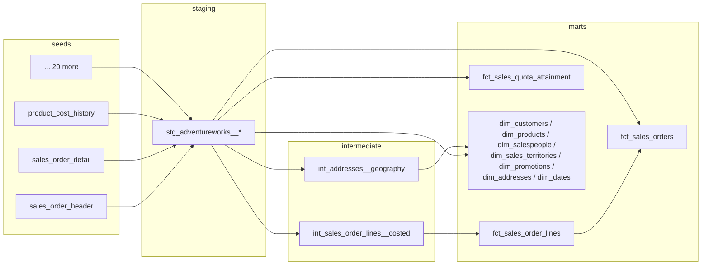

# AdventureWorks dbt

A dbt project that models the sales side of **AdventureWorks**, Microsoft's
classic sample database for a fictional bicycle manufacturer that sells online
to consumers and through a network of reseller stores.

It turns the normalized OLTP schema (about 23 tables from the `Sales`,
`Production`, `Person` and `HumanResources` schemas) into a tested star schema
for sales analytics: order and order-line facts, quota attainment, and
conformed dimensions for customers, products, salespeople, territories,
promotions, addresses and dates.

Runs locally on **DuckDB** with no setup, or on **Snowflake**.

## Quick start (DuckDB)

```bash
git clone https://github.com/asmith53499/adventureworks-dbt.git
cd adventureworks-dbt

python -m venv .venv && source .venv/bin/activate
pip install -r requirements.txt

dbt deps
dbt build        # loads seeds, builds models, runs every test (~10s)
```

The warehouse is written to `adventureworks.duckdb`. Explore it with the
DuckDB CLI or any SQL client:

```sql
select d.fiscal_year, p.product_category_name, sum(l.net_sales_amount) as sales
from main_marts.fct_sales_order_lines l
join main_marts.dim_dates d on l.order_date = d.date_day
join main_marts.dim_products p using (product_id)
group by all
order by 1, 3 desc;
```

Docs and lineage: `dbt docs generate && dbt docs serve`.

## Running on Snowflake

```bash
pip install -r requirements-snowflake.txt

export SNOWFLAKE_ACCOUNT=myorg-myaccount
export SNOWFLAKE_USER=me
export SNOWFLAKE_PRIVATE_KEY_PATH=~/.ssh/snowflake_key.p8
# optional - defaults shown
export SNOWFLAKE_ROLE=TRANSFORMER
export SNOWFLAKE_WAREHOUSE=TRANSFORMING
export SNOWFLAKE_DATABASE=ADVENTUREWORKS
export SNOWFLAKE_SCHEMA=DBT

dbt build --target snowflake
```

The connection uses key-pair authentication (see
[Snowflake's guide](https://docs.snowflake.com/en/user-guide/key-pair-auth)).
The role needs `USAGE` on the warehouse and `CREATE SCHEMA` on the database.

## Project layout

```
seeds/adventureworks/    raw tables as CSV (generated - see "Source data")
models/
  staging/               1:1 with raw tables: rename, cast, decode codes
  intermediate/          reusable joins (historical cost lookup, geography)
  marts/sales/           star schema: dim_* and fct_*
macros/                  cross-database helpers
tests/                   singular data tests
scripts/                 source data download/conversion
```



## Marts

| Model | Grain | Notes |
|---|---|---|
| `fct_sales_order_lines` | order line | Gross / discount / net sales, cost and margin. Order keys denormalized for easy slicing. |
| `fct_sales_orders` | order | Header amounts (subtotal, tax, freight, total due), rolled-up line measures, shipping days, billing currency, purchase reasons. |
| `fct_sales_quota_attainment` | salesperson x quota period | Sales vs. quota for each period between quota changes. |
| `dim_customers` | customer | Individual vs. store, name, territory, lifetime orders and sales. |
| `dim_products` | product | Category > subcategory > model hierarchy, line/class/style, list price and cost. |
| `dim_salespeople` | salesperson | Name, title, territory, commission. |
| `dim_sales_territories` | territory | Territory, country, group (North America / Europe / Pacific). |
| `dim_promotions` | special offer | Discount %, type, quantity bands. |
| `dim_addresses` | address | City, state, country, territory. |
| `dim_dates` | day | Calendar and fiscal (July-June) attributes. |

## Modeling notes

- **Margin uses historical cost.** `Product.StandardCost` is only the current
  cost. Order lines are joined to `ProductCostHistory` on the order date so
  margin reflects the cost at the time of sale. The few lines that predate a
  product's first cost record fall back to current cost and are flagged with
  `is_cost_estimated`.
- **Two kinds of customer.** A customer row is either an individual
  (`person_id`) or a reseller store (`store_id`, optionally with a
  `person_id` for the store contact). `dim_customers.customer_type` makes this
  explicit, and `customer_name` resolves to the right name for each.
- **Quota periods are derived.** Quotas are set roughly quarterly but on
  irregular dates, so each period runs from one quota date to the next
  (exclusive), and the last period is assumed to be three months. This logic
  is covered by a dbt unit test.
- **Natural keys.** AdventureWorks' integer IDs are stable and unique, so the
  marts use them as keys rather than generating surrogates.
- **Fiscal calendar.** AdventureWorks' fiscal year runs July-June and is named
  for the calendar year it ends in.
- **Cross-database SQL.** Models stick to SQL that DuckDB and Snowflake share,
  use dbt's cross-database macros (`dateadd`, `datediff`, `listagg`,
  `date_trunc`), and dispatch where the engines differ (`day_of_week_iso`).

## Testing

`dbt build` runs:

- generic tests: primary keys, foreign keys from every fact to its dimensions,
  accepted values and ranges
- singular tests (`tests/`): order subtotals reconcile to their lines,
  `total_due` matches its components, cost-history periods never overlap
- a unit test for the quota-period window logic

CI runs the full build on DuckDB for every push and pull request.

## Source data

The seeds are generated from Microsoft's
[AdventureWorks OLTP install script](https://github.com/microsoft/sql-server-samples/tree/master/samples/databases/adventure-works/oltp-install-script).
Those files aren't standard CSV. They have no header row, tables with XML
columns use `+|` / `&|` delimiters, and computed columns are included. So
`scripts/fetch_adventureworks.py` reads the column list and delimiters out of
the install script's DDL and rewrites each table as a clean CSV. It also drops
replication GUIDs, XML blobs and HR/payment fields that an analytics project
doesn't need.

To regenerate:

```bash
python scripts/fetch_adventureworks.py
```

The current version of Microsoft's data has its dates shifted forward, so
orders run from May 2022 to June 2025.

The AdventureWorks data is © Microsoft Corporation and MIT licensed. See
[seeds/adventureworks/NOTICE.md](seeds/adventureworks/NOTICE.md). The dbt
project itself is MIT licensed. See [LICENSE](LICENSE).
